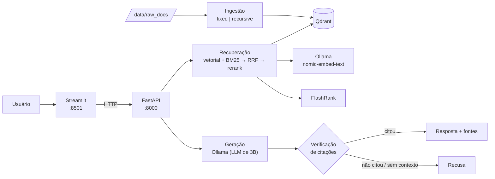

# RAG de nível de produção para documentação técnica

Assistente que responde dúvidas sobre uma documentação técnica **sempre citando a fonte**, **recusa quando a resposta não está na documentação** e mede com números qual estratégia de recuperação funciona melhor. Projeto do **Tema 4** da disciplina de IA na Programação (UniAnchieta), desenvolvido em grupo por 3 integrantes.

Tudo roda **localmente e a custo zero**, só com software livre e gratuito (Ollama, Qdrant, FlashRank, FastAPI, Streamlit) e sem nenhuma chave de API.

## Problema

Documentações técnicas grandes são difíceis de consultar, e assistentes baseados em LLM costumam inventar parâmetros, funções e comportamentos que não existem. Para uma documentação técnica, uma resposta errada e confiante é pior do que nenhuma resposta.

Este projeto ataca três perguntas, todas medidas na pasta `eval/`:

1. **Como dividir o texto?** Chunking de tamanho fixo (baseline) versus divisão recursiva por seções do Markdown.
2. **Como buscar?** Busca vetorial, BM25, híbrida (RRF) e híbrida com reranking.
3. **Como evitar alucinação?** Respostas só com citações verificáveis e recusa quando a documentação não cobre a pergunta.

**Métricas de sucesso:** Recall@k da recuperação por estratégia, taxa de respostas fundamentadas na fonte citada e taxa de recusas corretas em perguntas sem resposta (ver [docs/avaliacao.md](docs/avaliacao.md)).

**Base de conhecimento:** guia técnico em português do ecossistema FastAPI + Pydantic + pytest + Docker, em `data/raw_docs/` (ver [data/README.md](data/README.md)). O assistente responde **só** com base nesses documentos: perguntas fora deles, mesmo de conhecimento geral, como "O que é HTML?", são recusadas de propósito.

## Resultados

Avaliação oficial de 15/11/2026, com o Ollama real (`nomic-embed-text` e `qwen2.5:3b`), o conjunto de teste congelado (50 perguntas com resposta e 14 sem) e top-5. As saídas brutas estão em [`evidencias/avaliacao/`](evidencias/avaliacao/), e a análise completa em [docs/checklist-enunciado.md](docs/checklist-enunciado.md#3-resultados-oficiais-15112026).

| | Baseline `fixed + vector` | **Padrão `recursive + hybrid`** |
| --- | --- | --- |
| Recall@5 da recuperação | 80% | **92%** |
| Respostas fundamentadas, entre as respondidas | 80,8% | **93,5%** |
| Recusas corretas (perguntas sem resposta) | 92,9% | 92,9% |
| Falsas recusas | 48% | **38%** |

- **Reranker:** o `ms-marco-MultiBERT-L-12` derrubou o Recall@5 para 56–58%. Por isso o padrão é a busca híbrida sem reranking (ADR 002).
- **Limitações** (5 casos de falha analisados em [`evidencias/falhas/`](evidencias/falhas/casos-de-falha.md)):
  - uma alucinação passou pela verificação lexical (caso 3);
  - a verificação rígida recusa respostas corretas pouco citadas (caso 4).

## Arquitetura



Diagramas completos, camadas, contratos e decisões de arquitetura (ADRs) estão em **[docs/arquitetura.md](docs/arquitetura.md)**.

## Como instalar e rodar

> **Há dois caminhos para rodar o mesmo sistema. Eles não são etapas um do outro: escolha um só.**

| Você quer... | Caminho | Comando |
| --- | --- | --- |
| Desenvolver e testar no Windows (dia a dia do grupo) | **Windows** | `scripts\instalar.ps1` uma vez, depois `scripts\run_local.ps1` |
| Rodar como o professor vai rodar, gravar o vídeo da entrega ou usar Linux/macOS | **Docker** | `docker compose up --build` |

Os dois usam o mesmo código, a mesma documentação indexada e os mesmos modelos de IA, servidos pelo Ollama. Muda só o lugar onde as peças rodam: direto no Windows ou dentro de containers. Nenhum dos dois usa chave de API ou serviço pago.

### Em que máquina funciona

| Sistema | Caminho | Observação |
| --- | --- | --- |
| Windows 11 ou Windows 10 (versão 1809 ou mais nova) | Windows ou Docker | O `winget`, usado pelo instalador, já vem no sistema |
| Linux ou macOS | Docker | Os scripts `.ps1` são só para Windows |

| Requisito | Mínimo |
| --- | --- |
| Memória RAM | 8 GB (o modelo de 3B usa ~2,5 GB) |
| Disco livre | 6 GB no caminho Windows; ~10 GB no caminho Docker |
| Internet | Só na primeira instalação, para baixar programas e modelos |
| Permissão de administrador | Pode ser pedida pelo Windows ao instalar o Python e o Docker. O Ollama e o projeto instalam sem ela |
| GPU | Opcional. Sem GPU, cada resposta leva de 10 s a 60 s |

### Caminho Windows: instalação assistida

**1. Baixe o projeto** (uma vez):

```powershell
git clone https://github.com/eugustavocorreaDev/projetoIntegrador_unianchieta_GLR.git
cd projetoIntegrador_unianchieta_GLR
```

Sem Git, use **Code → Download ZIP** na página do repositório, extraia e abra o PowerShell na pasta extraída.

**2. Rode a instalação assistida** (uma vez, e de novo sempre que algo parecer errado):

```powershell
powershell -ExecutionPolicy Bypass -File scripts\instalar.ps1
```

O script confere cada item abaixo e, para o que faltar, **mostra de onde vai instalar e pergunta antes**. Os programas vêm pelo `winget`, a partir do instalador oficial de cada fabricante (python.org, ollama.com, git-scm.com, docker.com). Os pacotes Python vêm do PyPI, e os modelos, da biblioteca oficial do Ollama.

| # | Item | O que é conferido | Se faltar, o script... |
| --- | --- | --- | --- |
| 1 | Python 3.11+ | Versão instalada (3.11 é a mesma do Docker e da CI) | oferece instalar pelo `winget` |
| 2 | Ambiente virtual `.venv` | Existe e usa Python 3.11+ | cria |
| 3 | Dependências | Todas na versão fixada no `pyproject.toml` | instala ou corrige |
| 4 | Arquivo `.env` | Existe | copia do `.env.example` |
| 5 | Ollama | Instalado e aberto em `localhost:11434` | instala e abre |
| 6 | Modelo de embeddings `nomic-embed-text` (~270 MB) | Baixado e respondendo a um teste | baixa e testa |
| 7 | Modelo de geração `qwen2.5:3b` (~2 GB) | Baixado e respondendo a um teste | baixa, testa e deixa carregado na memória |
| 8 | Modelo de visão `qwen2.5vl:3b` (~3,2 GB, opcional) | Baixado | oferece baixar: permite perguntar enviando um print |
| 9 | Docker Desktop, Engine e Compose | Instalado e em execução | só oferece: é opcional neste caminho |
| 10 | RAM, disco e portas 8000/8501 | Recursos mínimos e portas livres | avisa |

No final, o script:

1. mostra o checklist e o resultado (`Caminho Windows: PRONTO, com IA real`);
2. pergunta se você quer iniciar o projeto;
3. se você confirmar, sobe a API, indexa a documentação e **valida a instalação de ponta a ponta**. Para isso, faz duas perguntas à API:
   - uma coberta pela documentação, que precisa ser respondida com citação;
   - uma fora dela ("O que é HTML?"), que precisa ser recusada;
4. abre a interface no navegador.

| Opção | Efeito |
| --- | --- |
| `-Verificar` | Só audita e mostra o checklist, sem instalar nem alterar nada |
| `-Sim` | Responde "sim" a todas as perguntas |
| `-ComDocker` | Trata o Docker como obrigatório e oferece instalá-lo |
| `-Modelo llama3.2:3b` | Usa outro modelo de geração de 3B |
| `-Iniciar` | No final, sobe e valida o projeto sem perguntar |

**3. No dia a dia**, para subir o sistema:

```powershell
powershell -ExecutionPolicy Bypass -File scripts\run_local.ps1
```

A API abre numa janela chamada "RAG API" e a interface abre no navegador, em <http://localhost:8501>. A documentação é indexada sozinha, e reindexada quando muda. Para parar, use `Ctrl+C` na janela da interface e feche a janela "RAG API".

A interface tem três abas:

| Aba | Para quê |
| --- | --- |
| 💬 **Perguntar** | Digite e tecle **Enter**. Dá para anexar um print, que o modelo de visão lê; a resposta continua vindo só da documentação, com citações |
| 📚 **Documentos** | Os 20 arquivos de `data/raw_docs/`, que são tudo o que o assistente sabe, com o texto, os chunks de cada estratégia e as perguntas de teste de cada arquivo |
| ✅ **Validação** | Roda o conjunto de teste ao vivo: Recall@k da recuperação, respostas fundamentadas e recusas corretas, com download em CSV |

> **Sem o Ollama**, o sistema ainda abre, no **Modo de Visualização (Mock)**: a busca, as citações e a recusa funcionam, mas as respostas não são geradas por IA e não valem como resultado. A interface avisa. Para sair dele, rode o `instalar.ps1` de novo.

### Caminho Docker: um comando, qualquer sistema

1. Instale e abra o [Docker Desktop](https://www.docker.com/products/docker-desktop/), gratuito para estudantes. No Windows, também dá para usar `scripts\instalar.ps1 -ComDocker`. Depois de instalar, reinicie o computador e espere o Docker Desktop mostrar "Engine running".
2. Na pasta do projeto, rode:

   ```bash
   docker compose up --build
   ```

3. Aguarde. Na primeira vez, leva de 5 a 15 minutos: baixa os modelos (~2,3 GB) e indexa a documentação sozinho. Depois, abra:
   - interface: <http://localhost:8501>
   - API (OpenAPI): <http://localhost:8000/docs>

Neste caminho não é preciso instalar Python nem Ollama: tudo roda em containers. Para parar, use `Ctrl+C` ou `docker compose down`.

Detalhes, GPU e solução de problemas: **[docs/instalacao.md](docs/instalacao.md)**.

### Variáveis de ambiente

Nenhuma é obrigatória: todas têm valor padrão, e o `instalar.ps1` cria o `.env` a partir do `.env.example`. O projeto **não usa chaves**. As principais:

| Variável | Padrão | Função |
| --- | --- | --- |
| `LLM_MODEL` | `qwen2.5:3b` | Modelo de geração (o instalador baixa este; `llama3.2:3b` também funciona) |
| `EMBED_MODEL` | `nomic-embed-text` | Modelo de embeddings |
| `CHUNK_STRATEGY` | `recursive` | `fixed` ou `recursive` |
| `CHUNK_SIZE` / `CHUNK_OVERLAP` | `800` / `120` | Tamanho e sobreposição dos chunks (caracteres) |
| `RETRIEVAL_MODE` | `hybrid` | `vector`, `bm25`, `hybrid` ou `hybrid_rerank` (o reranker piorou a recuperação na medição; ver ADR 002) |
| `TOP_K` | `5` | Trechos enviados ao LLM |
| `MIN_VECTOR_SCORE` | `0.0` | Limite de relevância para chamar o LLM (0 desativa) |
| `DOCS_DIR` | `data/raw_docs` | Documentação a indexar |
| `LLM_MODE` / `EMBED_MODE` / `QDRANT_MODE` | `ollama` / `ollama` / `server` | Modos oficiais; `mock` / `hash` / `local` só para desenvolvimento (o `run_local.ps1` ajusta sozinho) |

A lista completa está em [docs/instalacao.md](docs/instalacao.md#variáveis-de-ambiente).

### Testes e avaliação

```powershell
.\.venv\Scripts\python.exe -m ruff check .
.\.venv\Scripts\python.exe -m ruff format --check .
.\.venv\Scripts\python.exe -m pytest --cov        # não precisa de modelos nem de Docker
```

A avaliação oficial roda no caminho Docker, com o sistema no ar:

```bash
docker compose run --rm api python -m eval.run_eval --reindex --generate
```

## Estrutura do repositório

```text
README.md             este arquivo
PROMPTS.md            registro de uso de IA na programação
LICENSE               MIT
docker-compose.yml    ollama, ollama-pull, qdrant, ingest, api, frontend
docker/               Dockerfiles da API e da interface
.github/workflows/    CI: lint, testes e build das imagens
src/
  core/               configuração, tipos, erros, logs, fábrica de componentes e o RAGPipeline
  ingestion/          loader, chunking (fixed/recursive), embeddings, indexador, CLI
  retrieval/          Qdrant, BM25, RRF, reranker e Retriever
  generation/         prompt, cliente do LLM, verificação de citações e modo mock
  api/                FastAPI
  ui/                 Streamlit
tests/                testes unitários e de integração (sem modelos, com dublês)
eval/                 métricas, script de avaliação, dataset e resultados
data/                 base de conhecimento (raw_docs) e documentação externa (external, fora do Git)
scripts/              instalar.ps1 (instalação assistida), run_local.ps1 (caminho Windows),
                      verificar_dependencias.py e download da documentação oficial do FastAPI
evidencias/           vídeo, CI, avaliação, logs, prints, falhas e índice
docs/                 documentação técnica e trabalho de pesquisa em PDF
.claude/agents/       subagentes: arquiteto-revisor e auditor-rag-enunciado
```

## Integrantes e papéis

| Integrante | Responsabilidades | Papéis do enunciado que lidera |
| --- | --- | --- |
| **Integrante 1:** Gustavo Correa Lima (RA: 2530185) | Backend, Arquitetura, Pipeline RAG e Infraestrutura | Backend e Infraestrutura · IA e Avaliação (pipeline e prompts) |
| **Integrante 2:** Larissa Paula de Almeida Campos (RA: 2506209) | Dados, Dataset de Avaliação (50 perguntas) e Testes Automatizados | Dados e Qualidade · IA e Avaliação (dataset e métricas) |
| **Integrante 3:** Rafael Dourado Coimbra (RA: 2414807) | Interface Web, Documentação Técnica e Pesquisa ABNT | Produto e Interface |

### Regras do trabalho em equipe

1. **Todos os integrantes escrevem código** e fazem commits distribuídos no repositório. A tag `v1.0` precisa ter commits de todos.
2. **Revisão cruzada obrigatória:** nenhum integrante aprova o próprio pull request. Todo PR é revisado por outro membro do grupo antes do merge na `main`.
3. Código gerado por IA só entra na `main` com teste automatizado passando na CI.
4. Cada integrante sabe explicar qualquer parte do projeto, sem consultar a IA (defesa oral individual).

## Ferramentas de IA usadas no desenvolvimento

O uso de IA está registrado interação por interação em [PROMPTS.md](PROMPTS.md).

| Ferramenta | Uso | Plano / custo |
| --- | --- | --- |
| Claude Code (Anthropic) | Estrutura inicial, MVP, testes, documentação e os subagentes (`.claude/agents/`) | _Informe o plano usado e como ele atende à regra de custo zero_ |

Os subagentes `arquiteto-revisor` (arquitetura e código) e `auditor-rag-enunciado` (conformidade com o enunciado e a rubrica) **apoiam** a revisão, mas não substituem a revisão cruzada humana.

**Custo zero do produto:** o sistema entregue roda inteiro com software livre e gratuito (Ollama, Qdrant, FlashRank, FastAPI, Streamlit, Python), sem chave de API, hospedagem ou serviço pago.

## Bibliotecas, modelos e licenças de terceiros

| Componente | Licença |
| --- | --- |
| FastAPI, Pydantic, pydantic-settings, pytest, Ruff | MIT |
| Uvicorn, HTTPX | BSD-3-Clause |
| qdrant-client, Qdrant, Streamlit, FlashRank | Apache 2.0 |
| onnxruntime (dependência do FlashRank) | MIT |
| Ollama | MIT |
| Plus Jakarta Sans (fonte dos títulos, via Google Fonts) | SIL Open Font License 1.1 |
| `nomic-embed-text` | Apache 2.0 |
| `qwen2.5:3b` (padrão no Docker) | Qwen Research License (uso acadêmico/não comercial) |
| `llama3.2:3b` (alternativa opcional, `-Modelo llama3.2:3b`) | Llama 3.2 Community License |
| FlashRank `ms-marco-MultiBERT-L-12` | Ver ficha em <https://huggingface.co/prithivida/flashrank> |
| Documentação oficial do FastAPI (opcional, baixada por script) | MIT |

A base de `data/raw_docs/` é texto original do projeto (MIT). Fichas de dados e modelos estão em [docs/dados-e-modelos.md](docs/dados-e-modelos.md).

## Documentação

- [Documentação técnica](docs/README.md): arquitetura, instalação, API, dados e modelos, avaliação, testes, segurança e manual.
- [Checklist de conformidade com o enunciado](docs/checklist-enunciado.md): o que está atendido, parcial e pendente, e como conferir cada item.
- [Índice de evidências](evidencias/README.md)
- Trabalho de pesquisa (ABNT): `docs/pesquisa-abnt.pdf`

## Licença

[MIT](LICENSE)
