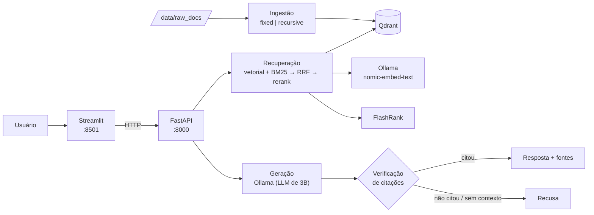

# RAG de nível de produção para documentação técnica

Assistente que responde dúvidas sobre uma documentação técnica **sempre citando a fonte**, **recusa quando a resposta não está na documentação** e mede com números qual estratégia de recuperação funciona melhor. Projeto do **Tema 4** da disciplina de IA na Programação (UniAnchieta), desenvolvido em grupo por 3 integrantes.

Tudo roda **localmente e a custo zero**, só com software livre e gratuito (Ollama, Qdrant, FlashRank, FastAPI, Streamlit) e sem nenhuma chave de API.

## Problema

Documentações técnicas grandes são difíceis de consultar, e assistentes baseados em LLM costumam inventar parâmetros, funções e comportamentos que não existem. Para uma documentação técnica, uma resposta errada e confiante é pior do que nenhuma resposta.

Este projeto ataca três perguntas, todas medidas na pasta `eval/`:

1. **Como dividir o texto?** Chunking de tamanho fixo (baseline) versus divisão recursiva por seções do Markdown.
2. **Como buscar?** Busca vetorial, BM25, híbrida (RRF) e híbrida com reranking.
3. **Como evitar alucinação?** Respostas só com citações verificáveis e recusa quando a documentação não cobre a pergunta.

**Métricas de sucesso:** Recall@k da recuperação por estratégia, taxa de respostas fundamentadas na fonte citada e taxa de recusas corretas em perguntas sem resposta (ver [docs/avaliacao.md](docs/avaliacao.md)).

**Base de conhecimento:** guia técnico em português do ecossistema FastAPI + Pydantic + pytest + Docker, em `data/raw_docs/` (ver [data/README.md](data/README.md)). O assistente responde **só** com base nesses documentos: perguntas fora deles, mesmo de conhecimento geral, como "O que é HTML?", são recusadas de propósito.

## Arquitetura



Diagramas completos, camadas, contratos e decisões de arquitetura (ADRs) estão em **[docs/arquitetura.md](docs/arquitetura.md)**.

## Como rodar

São dois fluxos independentes. Escolha **um** deles.

| | Fluxo A: oficial | Fluxo B: desenvolvimento local |
| --- | --- | --- |
| Para quê | Entrega, vídeo, avaliação e correção pelo professor | Programar e testar no Windows sem Docker |
| Precisa de | Docker Desktop | Python 3.11+ (Ollama opcional) |
| Comando | `docker compose up --build` | `scripts\run_local.ps1` |
| Banco vetorial | Qdrant em container | Qdrant embutido em disco (`.qdrant_local/`) |
| Modelos | Ollama em container (baixados automaticamente) | Ollama instalado no Windows; sem ele, modo de visualização (mock) |

### Fluxo A: execução oficial (Docker + Ollama)

1. Instale o [Docker Desktop](https://www.docker.com/products/docker-desktop/) e abra-o.
2. Na pasta do projeto, rode:

   ```bash
   docker compose up --build
   ```

3. Aguarde. A primeira execução baixa os modelos (~2,3 GB) e indexa a documentação sozinha. Depois, abra:
   - interface: <http://localhost:8501>
   - API (OpenAPI): <http://localhost:8000/docs>

Para parar, use `Ctrl+C` ou `docker compose down`. Mais detalhes, GPU e solução de problemas em [docs/instalacao.md](docs/instalacao.md#fluxo-a-execução-oficial-docker--ollama).

### Fluxo B: desenvolvimento local no Windows (sem Docker)

1. **Python 3.11+** instalado ([python.org](https://www.python.org/downloads/)).
2. **(Recomendado) Ollama para Windows**, para ter respostas geradas por IA de verdade:

   ```powershell
   winget install Ollama.Ollama          # ou baixe o instalador em https://ollama.com/download
   ollama pull llama3.2:3b               # modelo de geração (~2 GB)
   ollama pull nomic-embed-text          # modelo de embeddings (~270 MB)
   ollama list                           # confira se os dois aparecem
   ```

   Depois de instalado, o Ollama roda em segundo plano em `http://localhost:11434`.

3. **Suba o projeto:**

   ```powershell
   powershell -ExecutionPolicy Bypass -File scripts\run_local.ps1
   ```

   O script cria o `.venv` se faltar, indexa a documentação (e reindexa sozinho quando ela muda), abre a API numa janela chamada "RAG API" e abre a interface no navegador.

4. **Sem o Ollama**, o script entra no **modo de visualização (mock)**: as respostas organizam os trechos recuperados com as citações, mas **não são geradas por IA**. A interface mostra um aviso, e o relatório de `eval/` marca essas execuções como inválidas para resultados. Para sair do mock, faça o passo 2, feche a janela "RAG API" e rode o script de novo.

Detalhes em [docs/instalacao.md](docs/instalacao.md#fluxo-b-desenvolvimento-local-no-windows-sem-docker).

### Variáveis de ambiente

Nenhuma é obrigatória: todas têm valor padrão. Para mudar algo, copie `.env.example` para `.env`. O projeto **não usa chaves**. As principais:

| Variável | Padrão | Função |
| --- | --- | --- |
| `LLM_MODEL` | `qwen2.5:3b` | Modelo de geração (no Fluxo B, o script usa `llama3.2:3b` se for o que estiver instalado) |
| `EMBED_MODEL` | `nomic-embed-text` | Modelo de embeddings |
| `CHUNK_STRATEGY` | `recursive` | `fixed` ou `recursive` |
| `CHUNK_SIZE` / `CHUNK_OVERLAP` | `800` / `120` | Tamanho e sobreposição dos chunks (caracteres) |
| `RETRIEVAL_MODE` | `hybrid_rerank` | `vector`, `bm25`, `hybrid` ou `hybrid_rerank` |
| `TOP_K` | `5` | Trechos enviados ao LLM |
| `MIN_VECTOR_SCORE` | `0.0` | Limite de relevância para chamar o LLM (0 desativa) |
| `DOCS_DIR` | `data/raw_docs` | Documentação a indexar |
| `LLM_MODE` / `EMBED_MODE` / `QDRANT_MODE` | `ollama` / `ollama` / `server` | Modos oficiais; `mock` / `hash` / `local` só para desenvolvimento |

A lista completa está em [docs/instalacao.md](docs/instalacao.md#variáveis-de-ambiente).

### Testes e avaliação

```bash
pip install -e ".[dev,ui]"
ruff check . && ruff format --check . && pytest --cov            # não precisa de modelos

docker compose run --rm api python -m eval.run_eval --reindex --generate   # avaliação (Fluxo A no ar)
```

## Estrutura do repositório

```text
README.md             este arquivo
PROMPTS.md            registro de uso de IA na programação
LICENSE               MIT
docker-compose.yml    ollama, ollama-pull, qdrant, ingest, api, frontend
docker/               Dockerfiles da API e da interface
.github/workflows/    CI: lint, testes e build das imagens
src/
  core/               configuração, tipos, erros, logs, fábrica de componentes e o RAGPipeline
  ingestion/          loader, chunking (fixed/recursive), embeddings, indexador, CLI
  retrieval/          Qdrant, BM25, RRF, reranker e Retriever
  generation/         prompt, cliente do LLM, verificação de citações e modo mock
  api/                FastAPI
  ui/                 Streamlit
tests/                testes unitários e de integração (sem modelos, com dublês)
eval/                 métricas, script de avaliação, dataset e resultados
data/                 base de conhecimento (raw_docs) e documentação externa (external, fora do Git)
scripts/              run_local.ps1 (Fluxo B) e download da documentação oficial do FastAPI
evidencias/           vídeo, CI, avaliação, logs, prints, falhas e índice
docs/                 documentação técnica e trabalho de pesquisa em PDF
.claude/agents/       subagentes: arquiteto-revisor e auditor-rag-enunciado
```

## Integrantes e papéis

| Integrante | Responsabilidades | Papéis do enunciado que lidera |
| --- | --- | --- |
| **Integrante 1:** Gustavo Correa Lima (RA: 2530185) | Backend, Arquitetura, Pipeline RAG e Infraestrutura | Backend e Infraestrutura · IA e Avaliação (pipeline e prompts) |
| **Integrante 2:** `[PREENCHER NOME COMPLETO - RA: XXXXXXX]` | Dados, Dataset de Avaliação (50 perguntas) e Testes Automatizados | Dados e Qualidade · IA e Avaliação (dataset e métricas) |
| **Integrante 3:** `[PREENCHER NOME COMPLETO - RA: XXXXXXX]` | Interface Web, Documentação Técnica e Pesquisa ABNT | Produto e Interface |

### Regras do trabalho em equipe

1. **Todos os integrantes escrevem código** e fazem commits distribuídos no repositório. A tag `v1.0` precisa ter commits de todos.
2. **Revisão cruzada obrigatória:** nenhum integrante aprova o próprio pull request. Todo PR é revisado por outro membro do grupo antes do merge na `main`.
3. Código gerado por IA só entra na `main` com teste automatizado passando na CI.
4. Cada integrante sabe explicar qualquer parte do projeto, sem consultar a IA (defesa oral individual).

## Ferramentas de IA usadas no desenvolvimento

O uso de IA está registrado interação por interação em [PROMPTS.md](PROMPTS.md).

| Ferramenta | Uso | Plano / custo |
| --- | --- | --- |
| Claude Code (Anthropic) | Estrutura inicial, MVP, testes, documentação e os subagentes (`.claude/agents/`) | _Informe o plano usado e como ele atende à regra de custo zero_ |

Os subagentes `arquiteto-revisor` (arquitetura e código) e `auditor-rag-enunciado` (conformidade com o enunciado e a rubrica) **apoiam** a revisão, mas não substituem a revisão cruzada humana.

**Custo zero do produto:** o sistema entregue roda inteiro com software livre e gratuito (Ollama, Qdrant, FlashRank, FastAPI, Streamlit, Python), sem chave de API, hospedagem ou serviço pago.

## Bibliotecas, modelos e licenças de terceiros

| Componente | Licença |
| --- | --- |
| FastAPI, Pydantic, pydantic-settings, pytest, Ruff | MIT |
| Uvicorn, HTTPX | BSD-3-Clause |
| qdrant-client, Qdrant, Streamlit, FlashRank | Apache 2.0 |
| onnxruntime (dependência do FlashRank) | MIT |
| Ollama | MIT |
| Plus Jakarta Sans (fonte dos títulos, via Google Fonts) | SIL Open Font License 1.1 |
| `nomic-embed-text` | Apache 2.0 |
| `qwen2.5:3b` (padrão no Docker) | Qwen Research License (uso acadêmico/não comercial) |
| `llama3.2:3b` (alternativa, Fluxo B) | Llama 3.2 Community License |
| FlashRank `ms-marco-MultiBERT-L-12` | Ver ficha em <https://huggingface.co/prithivida/flashrank> |
| Documentação oficial do FastAPI (opcional, baixada por script) | MIT |

A base de `data/raw_docs/` é texto original do projeto (MIT). Fichas de dados e modelos estão em [docs/dados-e-modelos.md](docs/dados-e-modelos.md).

## Documentação

- [Documentação técnica](docs/README.md): arquitetura, instalação, API, dados e modelos, avaliação, testes, segurança e manual.
- [Índice de evidências](evidencias/README.md)
- Trabalho de pesquisa (ABNT): `docs/pesquisa-abnt.pdf`

## Licença

[MIT](LICENSE)
