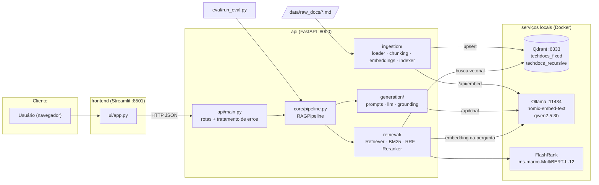
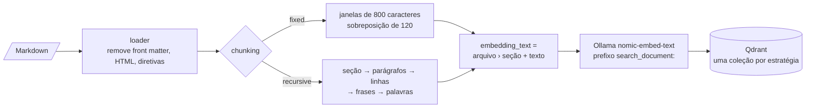
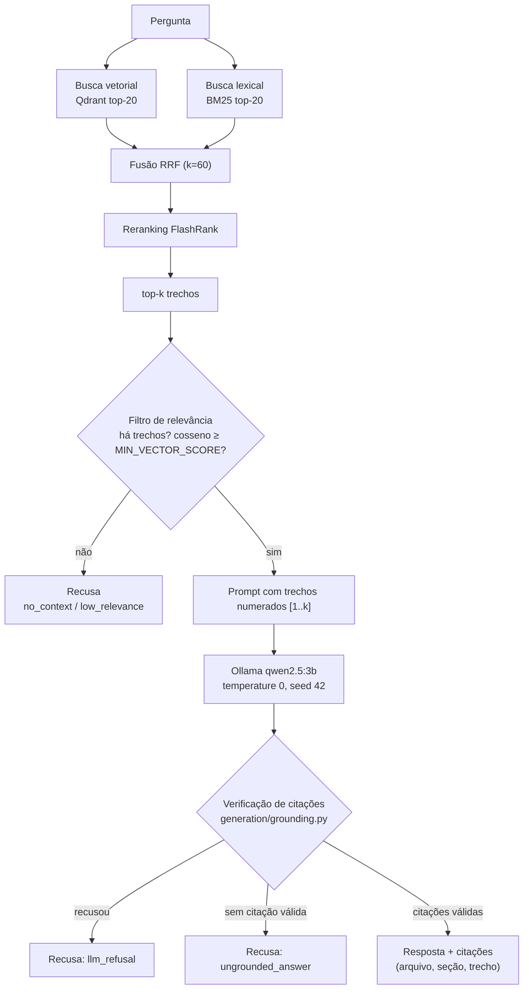

# Arquitetura do sistema

Este documento é a **referência oficial** da arquitetura do projeto. Todo código novo, humano ou gerado por IA, segue as camadas, os contratos e as decisões registradas aqui. Mudar uma decisão exige um ADR novo nesta página, num pull request com a CI verde e aprovado por **outro integrante** do grupo (revisão cruzada obrigatória). Os subagentes `arquiteto-revisor` e `auditor-rag-enunciado` apoiam essa revisão, mas não a substituem.

## 1. Visão geral

O sistema responde dúvidas sobre uma documentação técnica em Markdown. Cada afirmação da resposta cita o trecho de origem. Quando a documentação não cobre a pergunta, o sistema recusa com a mensagem fixa **"Não encontrei essa informação na documentação indexada."** em vez de inventar.

Tudo roda localmente e a custo zero: Ollama (embeddings e LLM), Qdrant (banco vetorial), FlashRank (reranker em ONNX, CPU), FastAPI e Streamlit.

### 1.1 Diagrama de componentes



### 1.2 Fluxo de dados

**Ingestão** (serviço `ingest` do compose, ou `python -m ingestion.cli`):



**Pergunta** (`POST /ask`):



Os modos `vector`, `bm25` e `hybrid` usam só parte desse fluxo e existem para a comparação experimental. Se o reranker falhar, `hybrid_rerank` cai para `hybrid` e a resposta informa o modo efetivo (`mode_effective`).

## 2. Camadas e regras de dependência

| Camada | Pasta | Responsabilidade | Pode importar |
| --- | --- | --- | --- |
| Núcleo | `src/core/` | Configuração (`config.py`), tipos de domínio (`schemas.py`), texto (`text.py`), erros, logging, a fábrica de componentes (`factory.py`) e o orquestrador `RAGPipeline` | todas as camadas de domínio |
| Ingestão | `src/ingestion/` | Ler e limpar Markdown, dividir em chunks, gerar embeddings, indexar | `core` (exceto `pipeline`), `retrieval.vector_store` |
| Recuperação | `src/retrieval/` | Qdrant, BM25, RRF, reranker e o `Retriever` que combina os modos | `core` (exceto `pipeline`), `ingestion.embeddings` (protocolo) |
| Geração | `src/generation/` | Prompt, cliente do LLM e verificação de citações | `core` (exceto `pipeline`) |
| API | `src/api/` | Traduz HTTP ↔ domínio, valida entradas, converte erros em status | `core` |
| Interface | `src/ui/` | Tela Streamlit | **nada do backend**: só HTTP para a API |
| Avaliação | `eval/` | Métricas e script de experimentos | `core`, `generation.grounding` |

Regras:

1. **Dependências apontam para dentro.** `ingestion`, `retrieval` e `generation` nunca importam `api` ou `ui`.
2. **Interfaces por protocolo.** `Embedder`, `LLM` e `Reranker` são `typing.Protocol`. Os testes trocam as implementações reais por dublês (`tests/conftest.py`) sem mudar o código de produção.
3. **Erros de domínio, não de biblioteca.** As camadas levantam exceções de `core/errors.py`; só `api/main.py` as converte em HTTP:

   | Exceção | Status HTTP | Quando |
   | --- | --- | --- |
   | `ServiceUnavailableError` (`EmbeddingError`, `LLMError`) | 503 | Ollama ou Qdrant fora do ar, modelo não baixado, tempo esgotado |
   | `CollectionNotFoundError` | 409 | Estratégia ainda não indexada |
   | `RAGError` (demais) | 500 | Falhas internas |
   | `RerankerError` | não chega à API | O `Retriever` degrada para `hybrid` |

4. **Configuração só por ambiente.** Todo parâmetro vem de `core/config.Settings` (variáveis de ambiente / `.env`). Nada de constantes mágicas espalhadas.
5. **Uma fábrica decide as implementações.** `core/factory.py` é o único lugar que escolhe entre Ollama e mock (`LLM_MODE`), Ollama e hashing (`EMBED_MODE`) e Qdrant servidor ou em disco (`QDRANT_MODE`). API, CLI e avaliação usam a fábrica, então enxergam sempre o mesmo índice. O modo oficial é `ollama/ollama/server`; os demais existem só para desenvolvimento (ver [instalacao.md](instalacao.md#caminho-windows)).
6. **Imports absolutos a partir de `src/`** (`from core.config import get_settings`). O `pytest` e o Docker colocam `src/` no `PYTHONPATH`.
7. **Toda função pública nova tem teste**, e os testes não dependem de rede (ver `docs/testes-ci.md`).

## 3. Contratos de entrada e saída

### 3.1 Tipos de domínio (`src/core/schemas.py`, dataclasses)

| Tipo | Campos principais | Uso |
| --- | --- | --- |
| `Document` | `source`, `title`, `text` | Saída do loader |
| `Chunk` | `id` (UUID5 determinístico), `text`, `source`, `section`, `chunk_index`, `strategy` | Unidade indexada no Qdrant (payload) |
| `RetrievedChunk` | `chunk`, `score`, `vector_score`, `bm25_score`, `rerank_score`, `stages` | Resultado da recuperação, com o rastro de cada estágio |
| `Citation` | `id` (número [n]), `source`, `section`, `chunk_id`, `excerpt` | Fonte citada na resposta |
| `AskResult` | `answer`, `refused`, `refusal_reason`, `citations`, `retrieved`, `mode_effective`, `latency_ms`, `timings_ms`, `raw_answer` | Saída do `RAGPipeline.ask` |

### 3.2 Contratos HTTP (`src/api/schemas.py`, Pydantic)

**`POST /ask`** e **`POST /search`**: entrada `QueryRequest`

| Campo | Tipo | Regra |
| --- | --- | --- |
| `question` | `str` | 3 a 1000 caracteres |
| `strategy` | `"fixed" \| "recursive" \| null` | padrão `CHUNK_STRATEGY` |
| `mode` | `"vector" \| "bm25" \| "hybrid" \| "hybrid_rerank" \| null` | padrão `RETRIEVAL_MODE` |
| `top_k` | `int \| null` | 1 a 20, padrão `TOP_K` |

**Saída de `/ask`**: `AskResponse`

```json
{
  "answer": "Use o dicionário app.dependency_overrides [1].",
  "refused": false,
  "refusal_reason": null,
  "citations": [
    {"id": 1, "source": "testes.md", "section": "Testes > Sobrescrevendo dependências",
     "chunk_id": "…", "excerpt": "Para trocar uma dependência real…"}
  ],
  "retrieved": [
    {"rank": 1, "chunk_id": "…", "source": "testes.md", "section": "…", "text": "…",
     "score": 0.97, "vector_score": 0.71, "bm25_score": 8.4, "rerank_score": 0.97,
     "stages": ["vector", "bm25", "rrf", "rerank"]}
  ],
  "strategy": "recursive", "mode": "hybrid_rerank", "mode_effective": "hybrid_rerank",
  "latency_ms": 8421.3, "timings_ms": {"retrieval": 312.0, "generation": 8101.2}
}
```

`refusal_reason` ∈ `no_context`, `low_relevance`, `llm_refusal`, `ungrounded_answer`.

**Saída de `/search`**: `SearchResponse` (`retrieved`, `strategy`, `mode_effective`, `latency_ms`), sem chamar o LLM.

**Outros endpoints**: `GET /health` (`status`, `qdrant`, `ollama`, `collections`), `GET /config` (configuração sem segredos), `POST /ingest` (`strategies` → estatísticas; desativável com `ENABLE_INGEST_ENDPOINT=false`). A referência completa e interativa fica em `http://localhost:8000/docs`.

## 4. Registros de decisão de arquitetura (ADRs)

### ADR 001: Qdrant como banco vetorial

- **Status:** aceito
- **Contexto:** precisamos de busca vetorial local, gratuita, que suba com `docker compose up` e que possa ser testada na CI sem servidor.
- **Decisão:** usar o Qdrant (imagem oficial `qdrant/qdrant`, licença Apache 2.0) com **uma coleção por estratégia de chunking** (`techdocs_fixed`, `techdocs_recursive`), distância de cosseno e payload com texto, arquivo e seção. Nos testes, o mesmo `qdrant-client` roda em memória (`QdrantClient(":memory:")`), e no desenvolvimento sem Docker roda embutido em disco (`QDRANT_MODE=local`).
- **Consequências:** as duas estratégias ficam indexadas lado a lado, o que permite compará-las na avaliação e na interface sem reindexar. O BM25 é montado em memória a partir do payload do Qdrant, então há uma única fonte de verdade.
- **Alternativas descartadas:**
  - *pgvector*: exigiria PostgreSQL e migrações; não roda em memória nos testes com a mesma API.
  - *FAISS / Chroma embutidos*: sem servidor separado, não representam a arquitetura de produção, e a persistência fica acoplada ao processo da API.
  - *Pinecone e outros serviços gerenciados*: violam a regra de custo zero.

### ADR 002: Busca híbrida (vetorial + BM25 com RRF) seguida de reranking

- **Status:** aceito em parte e **revisado em 14/11/2026 com números**. A busca híbrida virou o padrão; o reranking ficou só como opção de comparação.
- **Medição (14/11/2026):**
  - **Condições:** API real, `nomic-embed-text` via Ollama, as 50 perguntas com resposta, top-5, aba Validação / `POST /validation/retrieval`, mesma regra de `eval/run_eval.py`.

    | Modo | Recall@5 `fixed` | Recall@5 `recursive` |
    | --- | --- | --- |
    | `vector` | 90% | 90% |
    | `bm25` | 98% | 92% |
    | `hybrid` | **98%** | **96%** (MRR 0,86) |
    | `hybrid_rerank` | 58% | 60% |

  - **Causa:** a hipótese de que o FlashRank truncava os trechos (`max_length` padrão de 128 tokens) foi testada com 128, 256 e 512 e **descartada**: o Recall@5 ficou entre 56% e 70% em todos os casos. O modelo `ms-marco-MultiBERT-L-12` reordena mal trechos técnicos em português; ele chegou a dar nota 0,998 a trechos sem relação com a pergunta.
  - **Limitação:** os trechos esperados do conjunto de teste são literais, o que favorece o BM25.
  - **Confirmação oficial (15/11/2026):** `eval/run_eval.py`, conjunto de teste 2.1.0 (14 perguntas reescritas para reduzir o viés lexical), em `evidencias/avaliacao/20261115-172143-principal-recursive-hybrid/`. Recall@5:

    | Modo | `fixed` | `recursive` |
    | --- | --- | --- |
    | `vector` | 80% | 82% |
    | `bm25` | 92% | 90% |
    | `hybrid` | **92%** | **92%** (MRR 0,79) |
    | `hybrid_rerank` | 58% | 56% |

    A conclusão se mantém: a híbrida é a melhor, e o reranker piora a recuperação.
- **Contexto:** documentação técnica mistura linguagem natural ("como sobrescrever uma dependência") com identificadores exatos (`dependency_overrides`, `--proxy-headers`). Embeddings capturam o primeiro tipo e diluem o segundo; BM25 faz o contrário.
- **Decisão:** buscar 20 candidatos em cada método, combinar com **Reciprocal Rank Fusion** (k=60), que usa só a posição e dispensa normalizar escalas diferentes, e reordenar os candidatos com o cross-encoder multilíngue **FlashRank `ms-marco-MultiBERT-L-12`** (ONNX, CPU, sem PyTorch). O BM25 foi implementado à mão (`retrieval/bm25.py`), com tokenização sem acentos e divisão de identificadores com `_`.
- **Consequências:** o reranking custaria mais latência por pergunta (20 pares), e a medição mostrou que, com este modelo, ele **piora** a lista que o LLM vê. Por isso o padrão passou a ser `hybrid` (RRF), e trocar o modelo do reranker é trabalho futuro. Os quatro modos (`vector`, `bm25`, `hybrid`, `hybrid_rerank`) continuam selecionáveis para a avaliação; o baseline oficial é `fixed + vector`.
- **Alternativas descartadas:**
  - *Só vetorial*: mantida apenas como baseline.
  - *Combinação linear de pontuações*: exige calibrar pesos e normalizar cosseno contra BM25.
  - *Cross-encoder via sentence-transformers*: traria o PyTorch (~2 GB na imagem).
  - *Reranking com o próprio LLM*: lento demais em CPU com um modelo de 3B.

### ADR 003: Recusa estrita em três camadas (anti-alucinação)

- **Status:** aceito
- **Contexto:** o tema exige que o sistema diga que não sabe quando a resposta não está na documentação, e a rubrica mede a taxa de recusas corretas e de respostas fundamentadas. Modelos pequenos (3B) nem sempre obedecem ao prompt.
- **Decisão:** a recusa não depende só do LLM. Há três camadas, e só a do meio é probabilística:
  1. **Antes do LLM** (`RAGPipeline._gate`): sem trechos recuperados → `no_context`; similaridade de cosseno do melhor trecho abaixo de `MIN_VECTOR_SCORE` → `low_relevance`. Nos dois casos o LLM nem é chamado.
  2. **No prompt** (`generation/prompts.py`): usar só os trechos numerados, citar `[n]` em toda frase e responder a frase exata de recusa quando não houver resposta.
  3. **Depois do LLM, em código** (`generation/grounding.py`):
     - citações para trechos inexistentes são removidas;
     - uma recusa continua sendo recusa mesmo com citação;
     - as afirmações verificadas são as frases e os tópicos fora dos blocos de código. Uma linha de introdução terminada em ":" só conta se trouxer citação ("Use o dicionário X [1]:"). Correção de 15/11/2026: antes ela era sempre ignorada, e uma resposta correta no formato "explicação + código" (pergunta q22) era descartada com cobertura 0;
     - a resposta é **descartada e trocada pela recusa** (`ungrounded_answer`) quando não tem citação válida, quando menos de `MIN_CITATION_COVERAGE` (0,5) das afirmações têm citação, ou quando a maioria das afirmações citadas não compartilha pelo menos `MIN_SUPPORT_RATIO` (0,3) dos seus termos com os trechos que cita. Isso bloqueia conhecimento externo com uma citação qualquer, como "HTML é uma linguagem de marcação [1]".
     - **termos críticos (24/11/2026):** números, identificadores de código, qualificadores de escopo ("padrão", "sempre", "apenas"...) e negações da afirmação precisam existir no trecho citado; um só ausente recusa a resposta. A média da sustentação deixava passar "usa por padrão 1 worker" (caso 3);
     - **reparo e atribuição (24/11/2026):** antes de contar a cobertura, `_resolve` troca a citação com número errado por outro trecho **do mesmo documento** que sustente a frase sozinho, e dá citação à frase sem ela quando um único trecho a sustenta (`MIN_ATTRIBUTION_RATIO` = 0,6). Nunca entre documentos diferentes e nunca pelo pool do contexto inteiro.
     - A resposta original fica em `raw_answer` nos logs, junto com a cobertura e as frases sem sustentação, para análise.
- **Consequências:** a camada 3 pode recusar respostas corretas que o modelo esqueceu de citar (falso negativo). Esse custo é medido pela `false_refusal_rate` e pela `ungrounded_blocked_rate` em `eval/`. `MIN_VECTOR_SCORE` começa em 0 (desligado) e deve ser calibrado com o `best_threshold` que a avaliação calcula no **conjunto de desenvolvimento** (`eval/datasets/perguntas_dev.json`), usando a mesma estatística do filtro (`relevance_signal`). A checagem de sustentação é lexical: ela não garante que uma paráfrase com os mesmos termos esteja correta.
- **Alternativas descartadas:**
  - *Confiar só no prompt*: não é verificável e falha com modelos pequenos.
  - *LLM como juiz da fundamentação*: dobra a latência e também erra; fica como trabalho futuro.
  - *Limite fixo de similaridade sem calibração*: valores de cosseno variam por modelo e corpus.

## 5. Observabilidade

Os logs são JSON, uma linha por evento, com data e hora (`core/logging_setup.py`). Vão para o stdout e para `logs/app.log`. O evento `ask.completed` registra a pergunta truncada, a estratégia, o modo efetivo, os trechos recuperados com pontuações, a decisão (`answered` ou `refused:<motivo>`), as citações, a resposta bruta truncada e as latências por etapa. Esses arquivos são a fonte da evidência 4 (`evidencias/logs/`).
